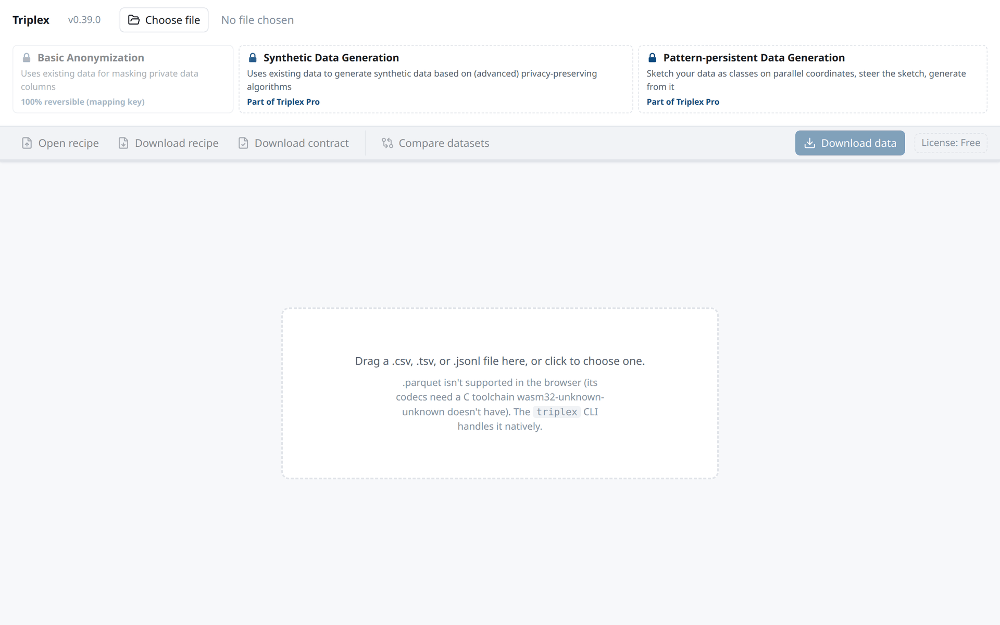
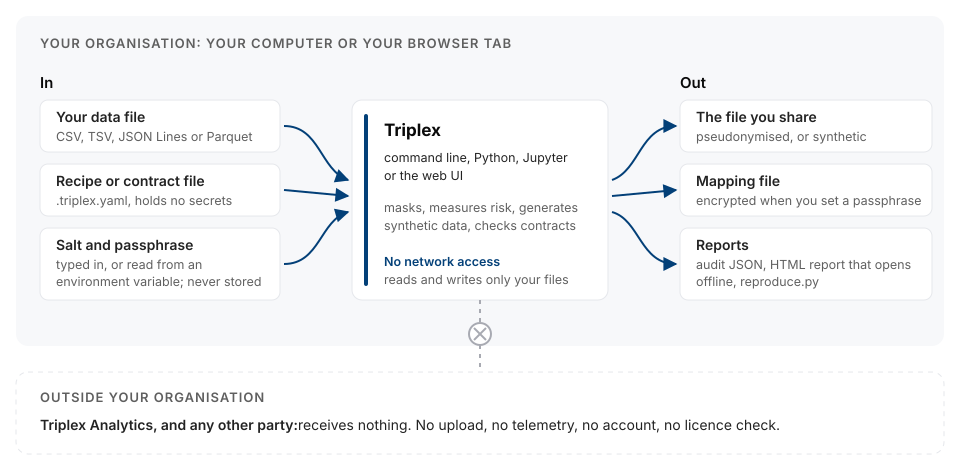
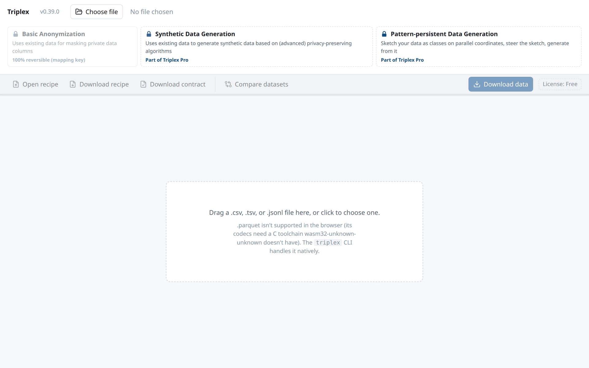
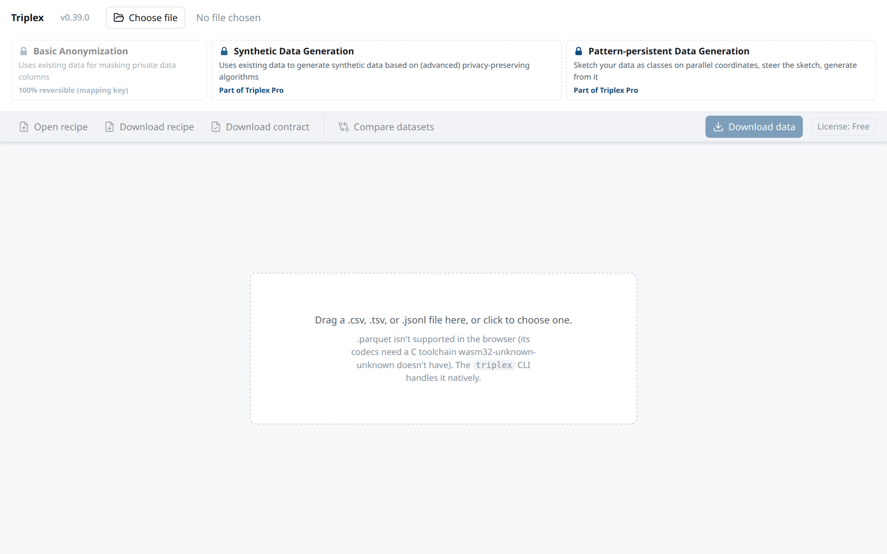
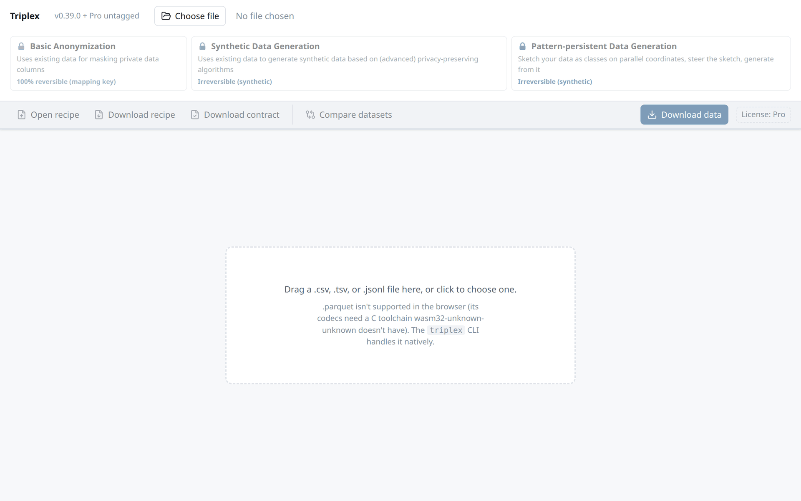
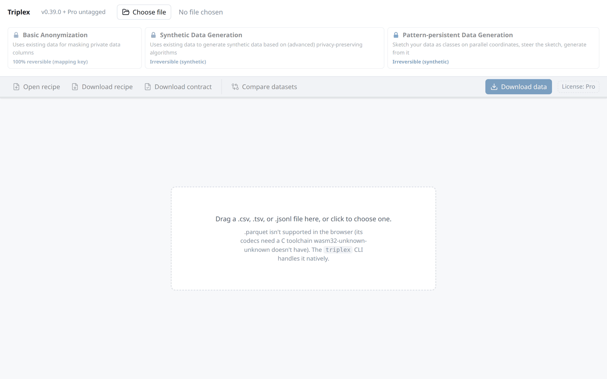

<div align="center">

# Triplex Analytics

**Mask it. Measure it. Make a synthetic copy. Without the data ever leaving your machine.**

Local-first data privacy tooling for the command line, Python, Jupyter and the browser.

[Website](https://triplexanalytics.io) ·
[Live demo](https://demo.triplexanalytics.io/) ·
[Use cases](https://triplexanalytics.io/evaluation-pack/recipes.html) ·
[Source code](https://github.com/triplexanalytics/triplex)

<br>



</div>

## Your data stays with you

No server, no upload, no telemetry, no account. Triplex reads your file on your computer or
inside your browser tab and writes the results next to it.

<p align="center">
  
</p>

## What it does

<table>
  <tr>
    <td width="50%" valign="top">
      <h3>Mask a real table</h3>
      Client numbers become tokens that still link across deliveries, names disappear,
      postcodes and birth years get coarser. A separate, encrypted mapping file lets you
      reverse it when you have to.
      <br><br>
      
    </td>
    <td width="50%" valign="top">
      <h3>Measure re-identification risk</h3>
      k-anonymity, l-diversity and t-closeness per column, per pair of columns and for the
      whole table, so you see who is still recognisable before you share anything.
      <br><br>
      
    </td>
  </tr>
  <tr>
    <td width="50%" valign="top">
      <h3>Generate synthetic data</h3>
      When Faker is not enough: new rows that keep the relations between columns, with a
      report on fidelity and on how close the rows sit to the originals.
      <br><br>
      
    </td>
    <td width="50%" valign="top">
      <h3>Steer it with a sketch</h3>
      See your data as classes on parallel coordinates, drag a class to the scenario you need
      to test, and generate from the sketch.
      <br><br>
      
    </td>
  </tr>
</table>

Every command writes the same three files: an audit JSON, an HTML report that opens offline and
a Python script that reproduces the numbers.

## Get started

```sh
cargo install triplex          # command-line tool
pip install triplexanalytics   # Python bindings
```

Or try the web UI on synthetic sample data at
[demo.triplexanalytics.io](https://demo.triplexanalytics.io/).

| | |
|---|---|
| [**triplex**](https://github.com/triplexanalytics/triplex) | The open-source core (Apache-2.0): one Rust engine behind the CLI, Docker image, web UI, Python bindings and Jupyter widget. SchemaCast, Anonymizer, DatasetCard, DriftGuard and ModelCard. |
| **Triplex Pro** | The paid extension of the web UI: synthetic data and sketch-based generation in the browser. On the command line and in Python, both are open source. |

## About us

Triplex Analytics was founded in 2021 as a data consultancy for municipal governments, work we
still do today. Our team includes data experts with PhD degrees, and our director is an
associate professor of Visual Data Science at Utrecht University.

[info@triplexanalytics.io](mailto:info@triplexanalytics.io) ·
[Report a security issue](https://github.com/triplexanalytics/triplex/blob/main/SECURITY.md)
